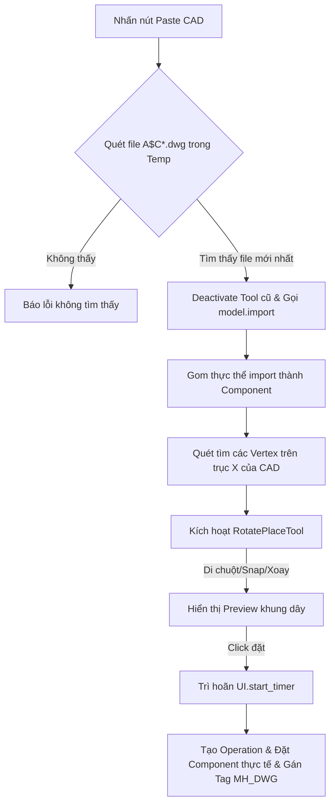

# MH DWG Clipboard Import - Paste CAD Clipboard to SketchUp

Tài liệu này ghi lại kết cấu kiến trúc, các tính năng và cơ chế hoạt động của plugin **MH DWG Clipboard Import** nhằm giúp AI và các nhà phát triển hiểu nhanh dự án để nâng cấp hoặc sửa lỗi mà không làm ảnh hưởng đến các tính năng hiện có.

---

## 1. Tổng quan dự án
**MH DWG Clipboard Import** là plugin hỗ trợ import nhanh bản vẽ CAD (định dạng `.dwg`) đang được lưu trong Clipboard của hệ điều hành Windows trực tiếp vào SketchUp. Plugin cung cấp một công cụ tương tác trực quan cho phép di chuyển, snap điểm và xoay bản vẽ 3 chiều nhanh trước khi đặt vào mô hình.

---

## 2. Cấu trúc thư mục

* **`MH_Dwg.rb`** (Ngoài cùng):
  - Khai báo extension `MH DWG Clipboard Import` với SketchUp.
  - Cấu hình thông tin cơ bản: Tác giả (`MH`), Phiên bản (`1.0.0`), mô tả và đăng ký load file `MH_Dwg/main.rb`.
* **`MH_Dwg/main.rb`** (Quan trọng nhất):
  - Xử lý tìm kiếm file DWG tạm trong thư mục Temp của hệ thống.
  - Gọi API import gốc của SketchUp để nhập bản vẽ.
  - Lớp tương tác màn hình `RotatePlaceTool` điều khiển việc di chuột, snap điểm neo, xoay trục và vẽ preview bản vẽ dưới dạng khung dây (wireframe).
* **`MH_Dwg/mh_dwg_debug.log`**:
  - File ghi log chi tiết mọi sự kiện hoạt động của plugin (paste start, import status, tool rotation, error stacktrace) dưới dạng JSON để phục vụ gỡ lỗi.

---

## 3. Các tính năng cốt lõi

1. **Tìm kiếm file CAD từ Clipboard tự động**:
   - Quét thư mục Temp của Windows (`ENV['TEMP']`) để tìm file CAD tạm thời (thường có dạng tên `A$C*.dwg` do AutoCAD sinh ra khi nhấn Ctrl+C).
   - Chọn file có thời gian chỉnh sửa mới nhất (`mtime`) để import.
2. **Xác định điểm neo đặt bản vẽ thông minh**:
   - Quét hình học trong bản vẽ CAD để tìm tất cả các đỉnh (vertices) nằm trên trục X của CAD (tọa độ Y ≈ 0, Z ≈ 0).
   - Người dùng có thể nhấn phím **Tab** để chuyển đổi qua lại giữa các điểm neo này, giúp việc căn lề bản vẽ CAD với các cấu kiện trong SketchUp dễ dàng hơn.
3. **Công cụ đặt & xoay tương tác (`RotatePlaceTool`)**:
   - **Snap điểm**: Tự động snap tâm đặt vào các vertex hiện có trong model trong bán kính 20 pixels.
   - **Phím tắt xoay nhanh**:
     - `Ctrl + Click` hoặc phím `Ctrl`: Xoay bản vẽ quanh trục đứng Z thêm 90°.
     - `Shift + Click` hoặc phím `Shift`: Xoay bản vẽ quanh trục Y thêm 90°.
     - `Alt + Click` hoặc phím `Alt`: Xoay bản vẽ quanh trục X thêm 90°.
     - Phím `Tab`: Chuyển đổi điểm đặt bản vẽ sang vertex kế tiếp.
4. **Tự động phân nhóm & Quản lý Tag**:
   - Tự động gom toàn bộ thực thể CAD mới import vào một `ComponentInstance` duy nhất.
   - Gán đối tượng CAD này vào Layer/Tag tên là `MH_DWG` để người dùng dễ dàng bật/tắt hiển thị.
5. **Cơ chế chống Crash (BugSplat)**:
   - File CAD lớn thường chứa hàng ngàn thực thể. Để tránh treo cứng hoặc sập SketchUp (BugSplat), plugin thực hiện import bên ngoài operation, đồng thời trì hoãn tác vụ đặt thật (`finalize_placement`) ra khỏi luồng sự kiện chuột thông qua `UI.start_timer(0.0)`.

---

## 4. Quy trình xử lý Paste CAD (Pipeline)

---

## 5. Quy tắc an toàn khi chỉnh sửa Code (Dành cho AI)

> [!IMPORTANT]
> - **Cấm lồng ghép Operation với Import**: Lệnh `model.import` tự quản lý transaction của nó. Tuyệt đối không được bọc lệnh `model.import` bên trong `model.start_operation` vì sẽ gây hỏng Undo Stack dẫn đến sập SketchUp.
> - **Trì hoãn đặt thật**: Thao tác gán tọa độ cuối cùng cho instance (`@inst.transformation = ...`) khi người dùng click chuột phải được gọi thông qua `UI.start_timer(0.0, false)` để đảm bảo luồng tương tác chuột của SketchUp Tool đã kết thúc an toàn.
> - **Giới hạn Preview**: Số lượng đường nét vẽ preview trên màn hình được giới hạn tối đa là 12,000 segments (`collect_preview_segments`) để tránh làm giảm FPS của viewport khi import các file CAD cực lớn.
