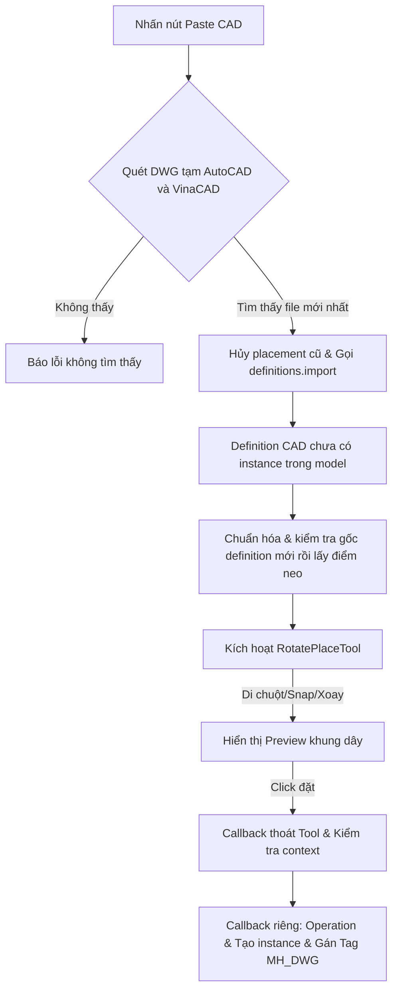

# MH DWG Clipboard Import - Paste CAD Clipboard to SketchUp

Tài liệu này ghi lại kết cấu kiến trúc, các tính năng và cơ chế hoạt động của plugin **MH DWG Clipboard Import** nhằm giúp AI và các nhà phát triển hiểu nhanh dự án để nâng cấp hoặc sửa lỗi mà không làm ảnh hưởng đến các tính năng hiện có.

## Bản test đang hoạt động: 1.2.5 — đặt native theo chuột

Lệnh `Paste CAD From Clipboard` mặc định gọi `paste_from_clipboard(:native)`: chọn DWG mới nhất → `definitions.import` → chuẩn hóa min XYZ thành gốc definition → `model.place_component(defn, false)`. Bản vẽ đi theo chuột bằng công cụ native của SketchUp, click đặt một lần, Esc hủy. Không tự đặt sẵn vào model rồi yêu cầu Move.

Nhánh native không dùng `RotatePlaceTool`, timer tạo instance, observer hay sửa Tag sau khi đặt. Vì vậy Ctrl/Shift/Alt xoay, Tab đổi neo riêng của MH_DWG và tự gán Tag `MH_DWG` tạm không áp dụng trong bản test. Không đổi active Tag của người dùng. Nhánh cũ còn trong code và có thể gọi rõ ràng `paste_from_clipboard(:custom)` để so sánh; không tự fallback sang nhánh cũ khi lỗi native.

1.2.4 đã xác nhận min XYZ về 0 nhưng người dùng vẫn báo crash khi bật Move gốc; do đó chưa đủ bằng chứng kết luận tọa độ xa là nguyên nhân. 1.2.5 chỉ thay công cụ đặt, vẫn dùng `definitions.import`, không phải toàn bộ pipeline File > Import thủ công. Chưa xác nhận đã hết crash hoặc lag lần import đầu.

Các phần mô tả `RotatePlaceTool`, phím xoay, timer và Tag bên dưới áp dụng cho nhánh custom cũ, không phải lệnh Paste mặc định của 1.2.5.

---

## 1. Tổng quan dự án
**MH DWG Clipboard Import** là plugin hỗ trợ import nhanh bản vẽ CAD (định dạng `.dwg`) đang được lưu trong Clipboard của hệ điều hành Windows trực tiếp vào SketchUp. Plugin cung cấp một công cụ tương tác trực quan cho phép di chuyển, snap điểm và xoay bản vẽ 3 chiều nhanh trước khi đặt vào mô hình.

---

## 2. Cấu trúc thư mục

* **`MH_DWG.rb`** (Ngoài cùng):
  - Khai báo extension `MH DWG Clipboard Import` với SketchUp.
  - Cấu hình thông tin cơ bản: Tác giả (`MH`), phiên bản `1.2.5`, mô tả và đăng ký load file `MH_DWG/main.rb`.
* **`MH_DWG/main.rb`** (Quan trọng nhất):
  - Quét hai kiểu file DWG tạm trong Temp: `A$C*.dwg` của AutoCAD và `.dwg` có `.tmp` cùng tên của VinaCAD; sau đó chọn file mới nhất.
  - Dùng `model.definitions.import` (SketchUp 2021.1+) với `preserve_origin: false`; không kích hoạt giao diện đặt instance của importer. Log thực tế cho thấy importer vẫn giữ tọa độ CAD ở xa trong 1.2.3. Bản 1.2.4 dịch toàn bộ hình học ở cấp root của definition mới chưa có instance về góc min XYZ, kiểm tra bounds trước khi cho đặt; không chỉnh definition của block con dùng chung.
  - Mặc định gọi `model.place_component(defn, false)` để SketchUp quản lý preview đi theo chuột và đặt/hủy. `RotatePlaceTool` chỉ còn ở nhánh custom để so sánh.
* **`MH_DWG/mh_dwg_debug.log`**:
  - File ghi log chi tiết mọi sự kiện hoạt động của plugin (paste start, import status, tool rotation, error stacktrace) dưới dạng JSON để phục vụ gỡ lỗi.

---

## 3. Các tính năng cốt lõi

1. **Tìm file CAD từ Clipboard tự động**:
   - Quét file `A$C*.dwg` của AutoCAD và file `.dwg` có `.tmp` cùng tên của VinaCAD (ví dụ `8f0.dwg` + `8F0.tmp`) trong Temp.
   - Gộp hai danh sách và chọn file có thời gian chỉnh sửa mới nhất để import.
2. **Xác định điểm neo đặt bản vẽ thông minh**:
   - Điểm neo mặc định là góc nhỏ nhất của toàn bộ bản vẽ: `definition.bounds.min` (min X, min Y, min Z), có tính cả block/group/component lồng nhau. Đây là góc bounding box, không bắt buộc là một vertex thật.
   - Phím **Tab** chuyển sang các điểm neo trên trục X của CAD (Y ≈ 0, Z ≈ 0), rồi quay lại góc nhỏ nhất; không lặp điểm mặc định.
3. **Công cụ đặt & xoay tương tác (`RotatePlaceTool`)**:
   - **Snap điểm**: Tự động snap tâm đặt vào các vertex hiện có trong model trong bán kính 20 pixels.
   - **Phím tắt xoay nhanh**:
     - `Ctrl + Click` hoặc phím `Ctrl`: Xoay bản vẽ quanh trục đứng Z thêm 90°.
     - `Shift + Click` hoặc phím `Shift`: Xoay bản vẽ quanh trục Y thêm 90°.
     - `Alt + Click` hoặc phím `Alt`: Xoay bản vẽ quanh trục X thêm 90°.
     - Phím `Tab`: Chuyển đổi điểm đặt bản vẽ sang vertex kế tiếp.
4. **Tự động phân nhóm & Quản lý Tag**:
   - Khi click đặt, tạo một `ComponentInstance` từ definition CAD ở vị trí và góc xoay cuối cùng.
   - Gán đối tượng CAD này vào Layer/Tag tên là `MH_DWG` để người dùng dễ dàng bật/tắt hiển thị.
5. **Cơ chế chống Crash (BugSplat)**:
   - Bản test 1.2.4 không chỉ dựa vào `preserve_origin: false`. Sau importer, chuẩn hóa gốc definition chưa có instance trong operation riêng bằng `transform_entities`, gọi `invalidate_bounds` và kiểm tra bounds.min gần 0. Nếu không đạt thì abort và không cho đặt. Không sửa các đối tượng CAD đã đặt trước đó.
   - Log ghi thời gian importer và chuẩn hóa riêng. Lần đầu có thể lag ngay trong importer native chạy trên main thread; các test không chứng minh đã hết lag/crash, không gọi SketchUp API từ worker thread.
   - Preview chỉ đọc definition và vẽ nét; chưa tạo instance trong model, không ẩn/hiện hoặc biến đổi instance tạm.
   - Khi click, thoát Tool trong callback riêng; sau đó tạo instance ở callback tiếp theo. Timer bị hủy nếu thoát tool, paste tiếp, đổi model, đổi edit path hoặc definition không còn hợp lệ.
   - Giữ model và edit context ban đầu; đổi tọa độ world sang tọa độ local trước khi đặt trong group/component đang sửa.
   - Bỏ watchdog đọc instance trễ sau khi đặt. Giới hạn preview 12,000 đoạn nét và chặn đệ quy definition lặp/quá sâu.
   - Đây là thay đổi gia cố luồng đặt. Test Ruby mô phỏng không chứng minh lỗi native SketchUp đã hết; cần kiểm tra lại trong SketchUp với bản vẽ gây lỗi.

---

## 4. Quy trình xử lý Paste CAD nhánh custom cũ (không mặc định)

---

## 5. Quy tắc an toàn khi chỉnh sửa Code (Dành cho AI)

> [!IMPORTANT]
> - **Không bọc importer trong Operation**: Dùng `model.definitions.import` độc lập; operation chuẩn hóa definition chỉ bắt đầu sau khi importer đã trả về và kết thúc trước preview. Operation đặt instance cuối cùng cũng độc lập.
> - **Không tạo instance tạm trong preview**: Giữ preview là dữ liệu nét; không quay lại luồng import instance → ẩn → biến đổi → hiện.
> - **Nhánh native mặc định**: Kết thúc operation chuẩn hóa trước `place_component`. Không bọc placement native trong operation riêng, không thêm callback/observer sửa geometry hoặc Tag sau khi click. Từ chối definition rỗng trước placement (SketchUp 2025 có lỗi native khi đặt definition rỗng).
> - **Nhánh custom: Đặt ngoài Tool callback**: Thoát Tool và tạo instance ở hai callback riêng; kiểm tra model, edit path, definition và hủy timer khi context đổi.
> - **Giới hạn Preview**: Số lượng đường nét vẽ preview trên màn hình được giới hạn tối đa là 12,000 segments (`collect_preview_segments`) để tránh làm giảm FPS của viewport khi import các file CAD cực lớn.

## 6. Kiểm tra

Chạy ngoài SketchUp: `ruby MH_DWG/tests/placement_test.rb`.
Test mô phỏng kiểm tra thứ tự tạo instance sau khi thoát Tool, Esc, đổi model/tool/edit path, definition bị vô hiệu hóa, paste liên tiếp, tọa độ nested context và xoay.
Test nhánh mặc định xác nhận gọi native placement một lần với `repeat: false`, góc min thành origin dù không có vertex ở đó, không có custom Tool/timer/instance/Tag mutation, hủy placement custom đang chờ, từ chối definition rỗng và không fallback nếu native placement lỗi. Các test này không mô phỏng được preview/Move native thực tế.
Test kiểm tra mỗi lần import nhận `preserve_origin: false`, importer vẫn trả về tọa độ ở xa thì chuẩn hóa về 0, không sửa child definition dùng chung/definition đã có instance, và abort nếu không dịch được. Cần import mới trong SketchUp, kiểm tra điểm đặt, Move/xoay và chờ sau thao tác để xác định bản test có hết lag/crash hay không.
