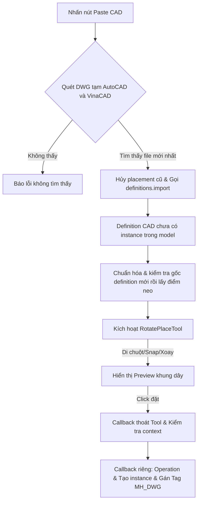

# MH DWG Clipboard Import - Paste CAD Clipboard to SketchUp

Tài liệu này ghi lại kết cấu kiến trúc, các tính năng và cơ chế hoạt động của plugin **MH DWG Clipboard Import** nhằm giúp AI và các nhà phát triển hiểu nhanh dự án để nâng cấp hoặc sửa lỗi mà không làm ảnh hưởng đến các tính năng hiện có.

## Bản test đang hoạt động: 1.2.12 — refactor có kiểm tra sau từng nhóm

Xử lý lần lượt phần import/chuẩn hóa, custom cũ và xoay native. Sau mỗi nhóm chạy toàn bộ test và RuboCop; chỉ chuyển nhóm tiếp theo khi test đạt. Cảnh báo theo cùng cấu hình `MH_DWG/.rubocop.yml`: **52 → 45 → 20 → 0**. Cấu hình và các ngưỡng kiểm tra giữ nguyên trong đợt 1.2.12, không thêm ngoại lệ để xóa cảnh báo.

- `geometry.rb` tách kiểm tra gốc, transaction chuẩn hóa và xác minh bounds; `import_pipeline.rb` tách import trong context đã chụp. Giữ importer ngoài operation và vẫn nhả khóa khi lỗi/reentrant call.
- `custom_state.rb`, `custom_preview.rb`, `custom_input.rb`, `custom_commit.rb` tách trạng thái, thu thập/vẽ wireframe, snap/neo, handoff hai timer và transaction tạo instance. `RotatePlaceTool` giữ callback SketchUp và lifecycle. Giữ Ctrl ưu tiên hơn Shift/Alt, Euler X*Y*Z, giới hạn preview và chống vòng lặp nested definition.
- `native_rotation_support.rb` tách xác minh cửa sổ/client Windows, xử lý phím/trạng thái và xây 24 wrapper; `native_rotation.rb` giữ bindings và controller. Giữ timer 40 ms, giới hạn đợi 50 tick, ưu tiên phím Z/Y/X, Euler Z*Y*X, Click thắng race, cache wrapper và WM_MOUSEMOVE cùng vị trí. Đây không phải một cách xoay/đặt mới hoặc bản sửa thêm vấn đề preview nhảy về origin.
- `load_tool_helpers` trong `main.rb` tháo method cũ được chuyển sang module trước khi include khi hot reload. Tránh code cũ còn nằm trên class che method mới sau reload qua VBO.

Kiểm chứng sau ba nhóm: 103, 106 rồi 107 tests đều đạt; bản cuối 690 assertions. Thêm test custom modifiers/snap/traversal và test method cũ bị thay đúng khi reload. RuboCop kiểm tra 17 file Ruby, 0 cảnh báo và không lỗi nội bộ. Giữ các test mô phỏng riêng với việc kiểm tra hoạt động native bằng tay.

## Bản 1.2.11 — dọn code và tách trách nhiệm

1.2.11 dọn cách trình bày Ruby, thêm mô tả, đổi tên tham số nội bộ rõ nghĩa, bỏ tham số callback không dùng và dùng đường dẫn UTF-8. `main.rb` còn 30 dòng để cleanup session cũ rồi load các phần:

| File | Trách nhiệm |
|---|---|
| `logging.rb` | Ghi log và lấy metadata an toàn |
| `clipboard.rb` | Tìm, kiểm tra và chọn DWG tạm |
| `geometry.rb` | Chuẩn hóa root mới và lấy điểm neo |
| `native_placement.rb` | Đặt native, chờ Select và gán Tag |
| `custom_placement.rb` | Công cụ đặt wireframe cũ |
| `native_rotation.rb` | Phím xoay và preview native hiện tại |
| `import_pipeline.rb` | Khóa import, kiểm tra context, điều phối đặt |

Giữ các API `MH::DWG` và thứ tự transaction, deferred callback, chuẩn hóa/placement/Tag. Bỏ lặp cách bắt lỗi đọc metadata và cách tìm điểm neo trên trục X. Nhánh custom có `getExtents` và `suspend` để preview không bị cắt bởi viewport và được vẽ lại khi tạm chuyển tool. Phần xoay chỉ đổi cú pháp tương đương và cách trình bày; không sửa thuật toán phím, thứ tự xoay, timer hoặc cập nhật chuột. Tên operation Undo được chuẩn hóa cách viết; Tag thực tế vẫn là `MH_DWG`.

RuboCop dùng cấu hình riêng `MH_DWG/.rubocop.yml`, kế thừa cấu hình chung. Giữ tên callback bắt buộc của SketchUp, cho phép các hàm API trả trạng thái thành công và bỏ giới hạn độ dài/độ phức tạp của test cùng các marker giả lập. Không tắt Metrics của code production hoặc tăng ngưỡng; khi tính độ dài method, một literal array/hash/heredoc được tính là một cấu trúc dữ liệu. `tools/mh_rubocop/scan.ps1 -Plugin MH_DWG` tự chọn cấu hình này; quét toàn bộ app vẫn dùng cấu hình chung.

Kết quả sau dọn: 52 cảnh báo Metrics, không còn cảnh báo trình bày/quy ước/lint/SketchUp trong cấu hình riêng. Với nguyên cấu hình chung trước đó: 194 cảnh báo, giảm từ 708. Chưa kết luận mọi cảnh báo độ phức tạp đều là lỗi; chúng vẫn được giữ trong báo cáo để xử lý tiếp có kiểm chứng.

## Bản 1.2.10 — sửa Tag khi Paste liên tiếp và kiểm tra context

1.2.10 sửa ba lỗi đã tái hiện trong kiểm tra code:

- Paste mới giữ lại danh sách CAD đã đặt nhưng đang chờ gán Tag của lần trước. Danh sách được chốt trước Paste tiếp, không thêm các bản copy tạo về sau. Chỉ gán khi trở lại Select, đúng model/edit context; bỏ đối tượng đã Undo/xóa. Không gán trong lúc importer đang chạy, kể cả importer xử lý timer UI giữa chừng. Import lần sau thất bại hoặc Esc hủy preview mới vẫn không làm mất Tag đang chờ của CAD trước.
- Chụp model, edit path và active entities trước import; kiểm tra lại sau khi thoát tool cũ, sau import và sau chuẩn hóa. Nếu context đổi thì dừng đặt và báo cần Paste lại, không đặt CAD nhầm group/component.
- Reload hủy cả timer tạo instance của nhánh custom cũ (trước/sau khi thoát tool), observer/timer Tag hiện tại và các lần Paste đang chờ. Callback cũ không tự tạo thêm đối tượng sau reload.

Giữ nguyên `native_rotation.rb` và hành vi xoay của 1.2.9 theo yêu cầu người dùng. Preview khi xoay vẫn có thể nhảy về origin; phiên bản này không sửa thêm vấn đề đó.

1.2.9 xử lý preview native quay về origin sau khi đổi hướng và chỉ cập nhật lại khi chuột di chuyển. Mỗi lần mở lại placement sau xoay, đọc vị trí chuột hiện tại và queue một `WM_MOUSEMOVE` vào cửa sổ SketchUp nhận chuột, đổi tọa độ screen sang client. Nếu native đã kích hoạt thì queue ngay trước khi callback trả về; nếu chưa thì đợi timer thấy đúng native placement. Chỉ thực hiện khi SketchUp ở foreground, cùng model/edit context, không giữ modifier/nút chuột và điểm nằm trong client area của cửa sổ thuộc SketchUp. Tôn trọng cửa sổ đang capture chuột. Không di chuyển con trỏ, không giả lập click, không tạo instance tạm hay sửa geometry đang preview. Nếu refresh thất bại thì ghi log, giữ placement và observer Tag. Cần xác nhận trực quan trên SketchUp thực tế.

Tham chiếu Win32: [WM_MOUSEMOVE](https://learn.microsoft.com/en-us/windows/win32/inputdev/wm-mousemove), [PostMessageW](https://learn.microsoft.com/en-us/windows/win32/api/winuser/nf-winuser-postmessagew). Message được queue bất đồng bộ, không gọi đồng bộ vào native tool từ callback Ruby.

1.2.8 sửa hai trường hợp lỗi: nếu đọc phím/focus, tạo timer hoặc cập nhật prompt khi khởi động xoay thất bại, chỉ dừng session xoay và giữ placement native cùng observer gán Tag; thông báo riêng rằng phím xoay không sẵn sàng. Khi quét Temp, ứng viên DWG bị mất hoặc không đọc được sẽ được ghi log và bỏ qua riêng, vẫn tiếp tục chọn file hợp lệ khác; thời gian sửa file đã đọc được dùng lại cho log thay vì đọc thêm lần nữa. Không thay đổi luồng importer, chuẩn hóa gốc CAD, phép xoay hay các operation Undo.

Lệnh `Paste CAD From Clipboard` mặc định gọi `paste_from_clipboard(:native)`: chọn DWG mới nhất → `definitions.import` → chuẩn hóa min XYZ thành gốc definition → `model.place_component(defn, false)`. Bản vẽ đi theo chuột bằng công cụ native của SketchUp, click đặt một lần, Esc hủy. Không tự đặt sẵn vào model rồi yêu cầu Move.

Nhánh native không dùng `RotatePlaceTool` hay timer tạo instance trong active entities. 1.2.7 thêm `native_rotation.rb`: khi preview đi theo chuột, bấm-thả **Ctrl → Z +90°**, **Shift → Y +90°**, **Alt → X +90°**. Đây là bấm-thả phím rồi click thường để đặt, không phải giữ modifier + click như nhánh cũ. Giữ phím không xoay liên tục; modifier đang giữ từ shortcut Paste hoặc lúc đổi focus không được tính là một lần xoay. Tab đổi neo chưa phục hồi ở nhánh native.

`NativeRotationSession` kiểm tra modifier/button qua Windows `GetAsyncKeyState` ở timer UI 40 ms, chỉ khi SketchUp ở foreground, không phải dialog, đúng tool placement native và đúng model/edit context. Không hook bàn phím, giả lập click, ghi nội dung phím hay chạy SketchUp API từ worker. Khi bấm-thả phím, thoát preview native rồi kiểm tra không có instance được đặt trước khi đổi hướng. Nếu click thắng thì dừng xoay và giữ Tag cho instance đã đặt.

Lần xoay đầu chuẩn bị 24 hướng vuông góc (23 wrapper definition + hướng gốc) trong operation riêng trước khi mở lại preview. Mỗi wrapper chỉ chứa một child instance trỏ tới CAD gốc, không nhân bản dữ liệu nét CAD. Những lần xoay sau chỉ đổi definition đặt native, không transform hình học hoặc đối tượng đã đặt. Giữ điểm neo gốc (góc min XYZ trước xoay) ở origin; không đổi neo theo bounding box sau xoay. Phép xoay kết hợp dùng thứ tự Z * Y * X như bản cũ. Wrapper tạo thêm một cấp component lồng nhau khi đặt bản đã xoay và các definition không dùng còn trong model; không purge/remove tự động để tránh sửa dữ liệu đang được native tham chiếu. Có thể preview làm mới khi đổi hướng; không cam kết phím xoay đã ổn định native trước khi người dùng test.

1.2.6 thêm `NativePlacementTagger` (ToolsObserver một lần), giữ nguyên trong 1.2.7: callback chỉ xếp một timer, khi native placement đã kết thúc và đang ở Select mới gán Tag `MH_DWG` cho các instance mới của đúng definition và đúng entities context. Không thay đổi active Tag, vị trí/góc xoay, geometry hay Tag của block con. Nếu Tag đã có thì dùng lại; nếu chưa thì tạo trong operation gán Tag.

Nếu người dùng bật Move/Orbit/tool khác ngay trước timer, chờ quay về Select rồi mới gán Tag, không cưỡng ép thoát tool. Esc không đặt gì, đối tượng Undo/xóa, definition/model không hợp lệ, đổi model/edit context, paste tiếp và reload đều không được phép gán nhầm. Observer/timer Tag được tháo trước thao tác gán Tag và khi hủy; không có observer quét toàn model. Timer nhận phím xoay dừng khi đặt/hủy, đổi model/edit context, paste tiếp và reload; Orbit tạm dừng nhận phím. Gán Tag là operation Undo riêng (`Tag CAD MH_DWG`), không ghép trễ vào operation native/người dùng: Undo lần đầu bỏ Tag, lần tiếp theo mới Undo placement (nếu không có thao tác xen giữa). Operation chuẩn bị hướng CAD cũng riêng và chỉ có ở lần xoay đầu.

Nhánh cũ còn trong code và có thể gọi rõ ràng `paste_from_clipboard(:custom)` để so sánh; không tự fallback sang nhánh cũ khi lỗi native.

1.2.4 đã xác nhận min XYZ về 0 nhưng người dùng vẫn báo crash khi bật Move gốc; do đó chưa đủ bằng chứng kết luận tọa độ xa là nguyên nhân. 1.2.5 chỉ thay công cụ đặt, vẫn dùng `definitions.import`, không phải toàn bộ pipeline File > Import thủ công. Người dùng xác nhận bản 1.2.5 hoạt động không bị out; đã lưu commit `8ad18aa` trước khi thêm Tag. Ngày 2026-10-06 người dùng xác nhận 1.2.6 không lỗi; đã lưu commit `19d92c1` trước khi thêm phím xoay. 1.2.7 vẫn cần kiểm tra native thực tế.

Các phần mô tả `RotatePlaceTool`, modifier + click và timer tạo instance bên dưới áp dụng cho nhánh custom cũ, không phải lệnh Paste mặc định của 1.2.7.

---

## 1. Tổng quan dự án
**MH DWG Clipboard Import** là plugin hỗ trợ import nhanh bản vẽ CAD (định dạng `.dwg`) đang được lưu trong Clipboard của hệ điều hành Windows trực tiếp vào SketchUp. Plugin cung cấp một công cụ tương tác trực quan cho phép di chuyển, snap điểm và xoay bản vẽ 3 chiều nhanh trước khi đặt vào mô hình.

---

## 2. Cấu trúc thư mục

* **`MH_DWG.rb`** (Ngoài cùng):
  - Khai báo extension `MH DWG Clipboard Import` với SketchUp.
  - Cấu hình thông tin cơ bản: Tác giả (`MH`), phiên bản `1.2.12`, mô tả và đăng ký load file `MH_DWG/main.rb`.
* **`MH_DWG/main.rb`** (Quan trọng nhất):
  - Quét hai kiểu file DWG tạm trong Temp: `A$C*.dwg` của AutoCAD và `.dwg` có `.tmp` cùng tên của VinaCAD; sau đó chọn file mới nhất.
  - Dùng `model.definitions.import` (SketchUp 2021.1+) với `preserve_origin: false`; không kích hoạt giao diện đặt instance của importer. Log thực tế cho thấy importer vẫn giữ tọa độ CAD ở xa trong 1.2.3. Bản 1.2.4 dịch toàn bộ hình học ở cấp root của definition mới chưa có instance về góc min XYZ, kiểm tra bounds trước khi cho đặt; không chỉnh definition của block con dùng chung.
  - Mặc định gọi `model.place_component(defn, false)` để SketchUp quản lý preview đi theo chuột và đặt/hủy. `RotatePlaceTool` chỉ còn ở nhánh custom để so sánh.
* **`MH_DWG/mh_dwg_debug.log`**:
  - File ghi log chi tiết mọi sự kiện hoạt động của plugin (paste start, import status, tool rotation, error stacktrace) dưới dạng JSON để phục vụ gỡ lỗi.

---

## 3. Các tính năng cốt lõi

1. **Tìm file CAD từ Clipboard tự động**:
   - Quét file `A$C*.dwg` của AutoCAD và file `.dwg` có `.tmp` cùng tên của VinaCAD (ví dụ `8f0.dwg` + `8F0.tmp`) trong Temp.
   - Gộp hai danh sách và chọn file có thời gian chỉnh sửa mới nhất để import.
2. **Xác định điểm neo đặt bản vẽ thông minh**:
   - Điểm neo mặc định là góc nhỏ nhất của toàn bộ bản vẽ: `definition.bounds.min` (min X, min Y, min Z), có tính cả block/group/component lồng nhau. Đây là góc bounding box, không bắt buộc là một vertex thật.
   - Phím **Tab** chuyển sang các điểm neo trên trục X của CAD (Y ≈ 0, Z ≈ 0), rồi quay lại góc nhỏ nhất; không lặp điểm mặc định.
3. **Công cụ đặt & xoay tương tác (`RotatePlaceTool`)**:
   - **Snap điểm**: Tự động snap tâm đặt vào các vertex hiện có trong model trong bán kính 20 pixels.
   - **Phím tắt xoay nhanh**:
     - `Ctrl + Click` hoặc phím `Ctrl`: Xoay bản vẽ quanh trục đứng Z thêm 90°.
     - `Shift + Click` hoặc phím `Shift`: Xoay bản vẽ quanh trục Y thêm 90°.
     - `Alt + Click` hoặc phím `Alt`: Xoay bản vẽ quanh trục X thêm 90°.
     - Phím `Tab`: Chuyển đổi điểm đặt bản vẽ sang vertex kế tiếp.
4. **Tự động phân nhóm & Quản lý Tag**:
   - Khi click đặt, tạo một `ComponentInstance` từ definition CAD ở vị trí và góc xoay cuối cùng.
   - Gán đối tượng CAD này vào Layer/Tag tên là `MH_DWG` để người dùng dễ dàng bật/tắt hiển thị.
5. **Cơ chế chống Crash (BugSplat)**:
   - Bản test 1.2.4 không chỉ dựa vào `preserve_origin: false`. Sau importer, chuẩn hóa gốc definition chưa có instance trong operation riêng bằng `transform_entities`, gọi `invalidate_bounds` và kiểm tra bounds.min gần 0. Nếu không đạt thì abort và không cho đặt. Không sửa các đối tượng CAD đã đặt trước đó.
   - Log ghi thời gian importer và chuẩn hóa riêng. Lần đầu có thể lag ngay trong importer native chạy trên main thread; các test không chứng minh đã hết lag/crash, không gọi SketchUp API từ worker thread.
   - Preview chỉ đọc definition và vẽ nét; chưa tạo instance trong model, không ẩn/hiện hoặc biến đổi instance tạm.
   - Khi click, thoát Tool trong callback riêng; sau đó tạo instance ở callback tiếp theo. Timer bị hủy nếu thoát tool, paste tiếp, đổi model, đổi edit path hoặc definition không còn hợp lệ.
   - Giữ model và edit context ban đầu; đổi tọa độ world sang tọa độ local trước khi đặt trong group/component đang sửa.
   - Bỏ watchdog đọc instance trễ sau khi đặt. Giới hạn preview 12,000 đoạn nét và chặn đệ quy definition lặp/quá sâu.
   - Đây là thay đổi gia cố luồng đặt. Test Ruby mô phỏng không chứng minh lỗi native SketchUp đã hết; cần kiểm tra lại trong SketchUp với bản vẽ gây lỗi.

---

## 4. Quy trình xử lý Paste CAD nhánh custom cũ (không mặc định)

---

## 5. Quy tắc an toàn khi chỉnh sửa Code (Dành cho AI)

> [!IMPORTANT]
> - **Không bọc importer trong Operation**: Dùng `model.definitions.import` độc lập; operation chuẩn hóa definition chỉ bắt đầu sau khi importer đã trả về và kết thúc trước preview. Operation đặt instance cuối cùng cũng độc lập.
> - **Không tạo instance tạm trong preview**: Giữ preview là dữ liệu nét; không quay lại luồng import instance → ẩn → biến đổi → hiện.
> - **Nhánh native mặc định**: Kết thúc operation chuẩn hóa trước `place_component`. Không bọc placement native trong operation riêng. Không sửa model trực tiếp trong callback observer; gán Tag phải nằm ở callback timer sau khi tool native kết thúc và đang Select. Không chỉnh geometry, active Tag hoặc Tag của block con. Từ chối definition rỗng trước placement (SketchUp 2025 có lỗi native khi đặt definition rỗng).
> - **Nhánh custom: Đặt ngoài Tool callback**: Thoát Tool và tạo instance ở hai callback riêng; kiểm tra model, edit path, definition và hủy timer khi context đổi.
> - **Giới hạn Preview**: Số lượng đường nét vẽ preview trên màn hình được giới hạn tối đa là 12,000 segments (`collect_preview_segments`) để tránh làm giảm FPS của viewport khi import các file CAD cực lớn.

## 6. Kiểm tra

Chạy ngoài SketchUp: `ruby MH_DWG/tests/placement_test.rb`.
Test 1.2.11 kiểm tra bounds preview custom theo transform, repaint khi suspend và giữ nguyên thứ tự/loại trùng/điểm gần trục X nhất của các điểm neo. Hai bộ test chính gồm 103 tests, 657 assertions.
Test 1.2.10 kiểm tra Paste liên tiếp trước timer/qua Move, chốt danh sách chờ Tag, bỏ bản copy tạo sau và CAD đã xóa, Esc preview mới, lỗi importer/lỗi gán Tag, không lồng operation importer, đổi context trong callback import/thoát tool/chuẩn hóa và reload khi timer custom đang chờ. Kiểm tra cả cleanup observer/timer và nhả khóa import.
Test riêng việc tìm file Temp thật (chạy ở process riêng vì bộ placement thay finder bằng stub): `ruby MH_DWG/tests/clipboard_discovery_test.rb`. Kiểm tra chọn file mới nhất giữa AutoCAD/VinaCAD, bỏ DWG không có .tmp tương ứng, một/tất cả ứng viên biến mất hoặc không đọc được và không đọc lại mtime chỉ để ghi log.
Test xoay + toàn bộ regression trước đó: `ruby MH_DWG/tests/native_rotation_test.rb`.
Test khởi động xoay kiểm tra lỗi snapshot bàn phím, focus, tạo timer và cập nhật prompt; placement vẫn hoạt động, observer Tag vẫn gán đúng CAD, timer lỗi được dừng và không báo nhầm lỗi import.
Test cập nhật preview kiểm tra chuột đứng yên, kích hoạt native ngay/trễ, mất focus, mouse click, hủy và lỗi refresh. Test Win32 dùng hàm giả lập để kiểm tra tọa độ client, màn hình có tọa độ âm, capture window, dialog, cửa sổ app khác và giới hạn client; không gửi thông điệp chuột tới cửa sổ thật trong test.
Kiểm tra bấm/thả từng trục, giữ phím, phím đang giữ từ shortcut/focus, 4 lần trở về hướng gốc, 24 hướng dùng chung CAD, không transform source, đúng thứ tự Euler/neo, Tag sau xoay, click thắng race, mouse drag/Orbit/Move/Esc/context/paste tiếp và lỗi keyboard/wrapper. Test mô phỏng không chứng minh hết crash native; cần bấm-thả các modifier khi preview, click đặt rồi bật Move trong SketchUp thực tế.
Test mô phỏng kiểm tra thứ tự tạo instance sau khi thoát Tool, Esc, đổi model/tool/edit path, definition bị vô hiệu hóa, paste liên tiếp, tọa độ nested context và xoay.
Test nhánh mặc định xác nhận gọi native placement một lần với `repeat: false`, góc min thành origin dù không có vertex ở đó, không có custom Tool/timer tạo instance/Tag mutation trong preview, hủy placement custom đang chờ, từ chối definition rỗng và không fallback nếu native placement lỗi. Test Tag xác nhận callback không sửa model, gán đúng component ở timer riêng, giữ transform/active Tag/block con, tái sử dụng Tag, Esc/Undo/xóa/đổi context/model/paste tiếp không gán nhầm, chờ Move kết thúc và cleanup observer. Các test này không mô phỏng được preview/Move native thực tế.
Test kiểm tra mỗi lần import nhận `preserve_origin: false`, importer vẫn trả về tọa độ ở xa thì chuẩn hóa về 0, không sửa child definition dùng chung/definition đã có instance, và abort nếu không dịch được. Cần import mới trong SketchUp, kiểm tra điểm đặt, Move/xoay và chờ sau thao tác để xác định bản test có hết lag/crash hay không.
