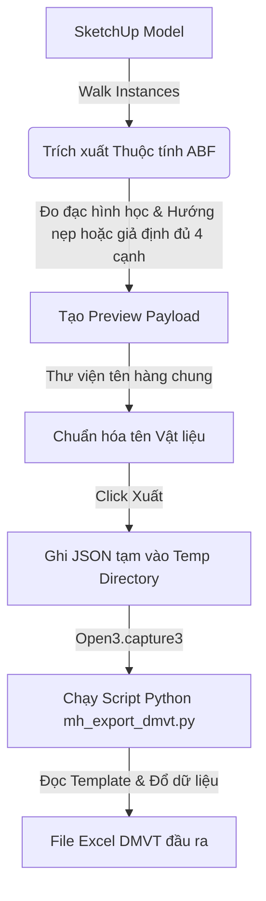

# MH Export - Excel Exporter for ABF in SketchUp

Tài liệu này ghi lại kết cấu kiến trúc, các tính năng và cách thức vận hành của plugin **MH Export** nhằm giúp AI và các nhà phát triển hiểu nhanh dự án để nâng cấp hoặc sửa lỗi mà không làm ảnh hưởng đến các tính năng hiện có.

---

## 1. Tổng quan dự án
**MH Export** là plugin hỗ trợ trích xuất dữ liệu định mức ván (sheets) và nẹp chỉ cạnh (edge bands) từ các đối tượng SketchUp đã được dán nhãn bởi **ABF**. Dữ liệu được thống kê chi tiết, chuẩn hóa mã vật liệu và xuất ra file Excel Định mức vật tư (DMVT) theo mẫu chuyên nghiệp.

---

## 2. Cấu trúc thư mục

* **`MH_EXPORT.rb`** (Ngoài cùng):
  - Khai báo extension `MH Export` với SketchUp.
  - Cấu hình thông tin cơ bản: Tác giả (`MH`), Phiên bản (`1.0.0`), mô tả và đăng ký load file `MH_EXPORT/main.rb`.
* **`MH_EXPORT/main.rb`** (Quan trọng nhất phía Ruby):
  - Quét mô hình SketchUp (`walk_instances`), lọc các thực thể ván ABF và trích xuất dữ liệu nẹp trên từng mặt cạnh.
  - Đồng bộ, phân nhóm (regroup) dữ liệu ván nẹp và chuẩn hóa mã vật tư thông qua ánh xạ cấu hình trong `MH_Registry`.
  - Tạo file JSON tạm và gọi script Python để xử lý ghi file Excel.
* **`MH_EXPORT/ui.html`**:
  - Giao diện HTML của hộp thoại báo cáo trước khi xuất (`UI::HtmlDialog`). Hiển thị bảng xem trước (Preview) khối lượng ván nẹp và các tùy chọn cấu hình xuất.
* **`MH_EXPORT/exporter/mh_export_dmvt.py`** (Bộ lõi ghi Excel):
  - File script Python đảm nhận việc đọc file Excel template mẫu, đổ dữ liệu từ JSON vào các dòng/cột tương ứng và định dạng bảng Excel đầu ra.

---

## 3. Các tính năng cốt lõi

1. **Thống kê chi tiết khối lượng ván & nẹp**:
   - Tính tổng số tấm ván cần dùng dựa trên số lượng tấm lồng (nesting sheets) của ABF.
   - Đo tổng mét dài (linear meters) của từng loại nẹp chỉ cạnh được dán thực tế trên các tấm ván.
   - Có tùy chọn **Giả định dán nẹp toàn bộ tấm**: plugin chỉ bổ sung các cạnh nhỏ chưa có nẹp ABF, theo nẹp chính/phụ đang chọn trong `MH_nep`; cạnh đã dán được giữ nguyên và không bị tính thêm lần nữa.
   - Dòng nẹp được gom theo mã vật liệu của tấm ván; mã `EdgeBandType` chỉ dùng để xác định loại nẹp và hệ số áp dụng.
2. **Chuẩn hóa mã vật liệu thông minh**:
   - Tra cứu tên hàng bằng thư viện chung tại `D:/Cong viec/config/nhap_xuatvan/material_code_library.xlsx`, cùng bộ dịch `material_item_names.py` mà app Python Xuất/nhập ván sử dụng. Đọc sheet mapping của chính thư viện vật liệu dùng bởi hệ MH_. Tên được ghép theo chất liệu, tiêu chuẩn, nhà cung cấp và bề mặt; dòng tắt bị bỏ qua.
   - Tên hàng viết hoa toàn bộ; dịch `1M` → `1 MẶT`, `2M` → `2 MẶT`, `-BCT` → `BACKER TRẮNG`, `-BCĐ` → `BACKER ĐEN` (kể cả dạng ghép `.1M-BCT`). Các ký hiệu này vẫn được giữ nguyên trong cột mã vật liệu.
   - Tự động loại bỏ hậu tố chỉ định mã màu sơn (`strip_paint_suffix`) khi cần nhóm gộp vật liệu ván thô (không phân biệt bóng/mờ/sơn).
   - Tự động đoán nhận vật liệu của tấm ván chưa gán nhãn dựa trên độ dày đo được từ hình học thực tế (`infer_material_by_thickness`).
3. **Phân loại cạnh dán nẹp (ABF Excel Data)**:
   - Chiếu hệ trục tọa độ của tấm ván để xác định chính xác các cạnh được dán nẹp nằm ở phía nào (Trên - top, Dưới - bot, Trái - left, Phải - right).
   - Tính toán kích thước cắt tinh (cutting size) bằng cách lấy kích thước phủ bì trừ đi độ dày nẹp tương ứng.
4. **Xuất Excel thông qua cầu nối Python**:
   - Sử dụng lệnh hệ thống (`Open3.capture3`) để khởi chạy trình thông dịch Python chạy script `mh_export_dmvt.py`.
   - File Excel đầu ra được sinh ra dựa trên file mẫu `DMVT-VAN.xlsx` để giữ nguyên các công thức tính toán, định dạng viền, màu sắc và font chữ của doanh nghiệp.

---

## 4. Quy trình luồng xuất dữ liệu (Data Pipeline)

---

## 5. Quy tắc an toàn khi chỉnh sửa Code (Dành cho AI)

> [!IMPORTANT]
> - **Giữ tính độc lập với MH_shared**: Để đảm bảo plugin MH Export hoạt động độc lập, các hàm bổ trợ hình học đã được sao chép trực tiếp vào module `MH::Export::Geometry`. Không được tự ý import thư viện dùng chung ngoài nếu không thực sự cần thiết.
> - **Cú pháp gọi Python**: Đảm bảo đường dẫn file Python và file Excel template được đọc chính xác từ registry hoặc đường dẫn mặc định. Khi chỉnh sửa cấu trúc dữ liệu JSON xuất ra, phải đồng bộ cập nhật logic đọc file JSON bên phía script Python (`mh_export_dmvt.py`).
> - **Đồng bộ hóa tên trường**: Các tên cột trong mảng dữ liệu xuất (`abf_excel_data`) phải trùng khớp với tiêu chuẩn định dạng xuất của ABF để các phần mềm tối ưu cắt ván (như CNC Nesting) có thể nhận dạng đúng.

## Thư viện vật liệu chung (13/10/2026)

- File hoạt động: `D:/Cong viec/config/nhap_xuatvan/material_code_library.xlsx` và
  `D:/Cong viec/config/nhap_xuatvan/material_item_names.py`.
- `MH_shared/material_item_names.rb` gọi bộ dịch Python chung một lần cho cả
  danh sách mã. Các lần xem lại dùng cache; cache tự hết hiệu lực khi file đổi.
- `MH_shared/material_item_names.py` là source để triển khai bộ dịch vào thư mục
  chung. Hai app chạy file trong thư mục chung, không chạy một bản dịch đóng gói
  riêng. Khi phát hành thay đổi bộ dịch, copy source này vào thư mục chung.
- Dùng nút Mở thư viện trong app Python để chỉnh bảng mã. Lưu Excel rồi xem lại
  bảng MH_EXPORT để nạp thay đổi; không cần khởi động lại SketchUp.
- Mã nguyên phần được nhận theo dấu ghép trong sheet material_code_rules; mã
  LK/MS cũ tương thích với LAM/MEL khi chưa có mã riêng. Chỉ đổi Tên hàng; mã gốc,
  số lượng, nẹp và dữ liệu ABF giữ theo luồng xuất hiện có.
- Thiếu/hỏng thư viện sẽ báo lỗi. Không tự quay lại bảng tên hàng cũ.
- Có thể đổi cả thư mục qua biến môi trường `MH_NHAP_XUATVAN_LIBRARY` cho
  cả hai app. Mặc định luôn là đường dẫn trên, không phụ thuộc thư mục mở app.
- Kiểm thử Ruby: `ruby MH_EXPORT/test/item_name_test.rb`.

- `MH_shared/material_library.rb` là đường dẫn chung cho MH::Registry,
  MH::RegistryApp và bộ dịch tên hàng. Workbook cũ đã được chuyển nguyên vẹn
  (đủ 11 sheet), giữ backup `.backup_*` trong MH_shared/data.
- Kiểm thử đường dẫn/đọc/ghi thư viện: `ruby MH_shared/test/material_library_test.rb`.
- `config.xlsx` cũ không còn được dùng. Khi đổi code/đường dẫn, mở lại SketchUp
  và app Python; khi sửa dữ liệu tên hàng, chỉ cần lưu Excel rồi xem lại.

## Kích thước khi xuất Excel

Cột Kích thước/Dày của dòng ván lấy độ dày danh nghĩa trong mã vật liệu,
không thêm mm: GGT.18 → 18; MDFCA.17.AC → 17, kể cả đo thực tế là 17.6.
Phần số phải đứng ngay sau chất liệu; không đọc nhầm E1 hoặc mã màu.
Mã không ghi độ dày giữ giá trị cũ. Nẹp giữ độ dày riêng của nẹp.
Quy tắc áp dụng ở MH_EXPORT (cả preview và file XLSX), app Python nhập/xuất
ván, xuất vật liệu MH_Thongke và các báo cáo qua MH::ExcelBridge.
