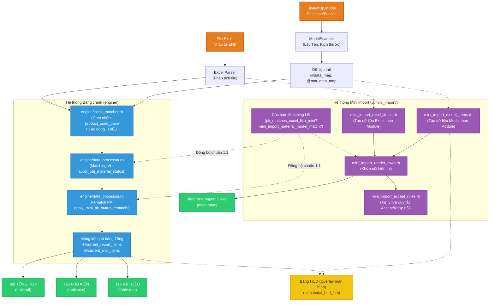

# Cấu trúc Tab, Table và Luồng Dữ Liệu Giao Diện MH_Thongke

Tài liệu này liệt kê chi tiết các thành phần UI (Tab, Table) và mô tả luồng dữ liệu (Data Flow) từ lúc đọc Model/Excel đến khi hiển thị lên giao diện, đảm bảo đồng bộ với hệ thống **Mini Import**.

---

## 1. Luồng Dữ Liệu (Data Flow Pipeline)

Hệ thống được chia làm 2 nhánh xử lý với 2 mục đích giao diện khác nhau nhưng **được đồng bộ bộ quy tắc (matching rules)** để ra số liệu khớp nhau 100%.

### Chi tiết Phân tách 2 Hệ thống:

1. **Hệ thống Bảng chính (TỔNG HỢP)**:
   - Xử lý chủ yếu tại thư mục `engine/` để quét hàng loạt toàn bộ dự án.
   - File chính: `engine/data_processor.rb` (Quét model và gọi các hàm xử lý cuối cùng).
   - File ghép nối: `engine/excel_matcher.rb` (Thuật toán gom nhóm theo `product_code_base` và so sánh với Excel, chỉ tạo dòng THIẾU nếu model có mã đó).

2. **Hệ thống Mini Import**:
   - Xử lý cô lập hoàn toàn trong thư mục `ui/mini_import/` để xử lý chi tiết tương tác từng Module.
   - File tạo dữ liệu Model: `ui/mini_import/mini_import_model_items.rb`
   - File tạo dữ liệu Excel: `ui/mini_import/mini_import_excel_items.rb`
   - File khớp nối hiển thị: `ui/mini_import/mini_import_render_rows.rb`
   - File xử lý lưu quy tắc (Accept): `ui/mini_import/mini_import_accept_rules.rb`

👉 **Điểm đồng bộ**: Bảng chính (Tại file `data_processor.rb`) ở bước cuối cùng sẽ gọi các hàm matching của Hệ thống Mini Import (`pk_matches_excel_like_mini?` và `mini_import_material_model_match?`) để định đoạt trạng thái. Đảm bảo dù 2 luồng riêng nhưng dùng chung 1 "bộ não".

---

## 2. Danh Sách Các Bảng Giao Diện (UI Tables)

### 2.0. Giao Diện Mini Import và HUD
Đây là các giao diện tách rời khỏi bảng tổng, tập trung vào công tác đối chiếu thủ công và thao tác nhanh trên viewport:
- **`Bảng Mini Import (id="main-table")`**: Bảng chứa danh sách linh kiện rút gọn, hiển thị tại file `mini_import_dialog_html.rb`. Dữ liệu hiển thị trong thẻ `<tbody id="table-body">`.
- **`Bảng HUD Overlay`**: Bảng trong suốt hiển thị trôi nổi ngay trên màn hình SketchUp (`ui/material_hud*.rb`). Nó trích xuất dữ liệu từ mảng của bảng chính kết hợp với `mini_model_items` để hiển thị nhanh khối lượng vật tư mà không cần mở bảng lớn.

### 2.1. Tab TỔNG HỢP (`id="tab-all"`)
Tab này có góc nhìn toàn cảnh về dự án và chứa 2 bảng:
- **`id="led-mini-stat-table"`**: Bảng *"Mini thống kê LED / cảm biến"* (nằm ở phía trên). Bảng này lọc riêng các thiết bị là đèn LED hoặc cảm biến để hiển thị nhanh.
- **`id="table-all"`**: Bảng *"Thống kê tổng hợp"* (nằm ở phía dưới). Hiển thị chi tiết tất cả Phụ kiện và Vật liệu của từng Mã SP gom chung vào một bảng. Sử dụng dữ liệu trực tiếp từ pipeline bảng chính.

### 2.2. Tab TỔNG DỰ ÁN (`id="tab-project-total"`)
- **`id="table-project-total"`**: Bảng tổng kết số lượng gom gộp toàn dự án. Hiển thị thu gọn (`data-compact="1"`), cộng dồn số lượng theo tên linh kiện mà không chia chi tiết theo Mã SP.

### 2.3. Tab PHỤ KIỆN (`id="tab-report"` -> Đề xuất đổi thành `id="tab-acc"`)
- **`id="table-acc"`**: Bảng chuyên sâu chỉ chứa Phụ kiện.
  - *Lưu ý về nguồn dữ liệu*: Tab này có 2 chế độ (Scope):
    - **Toàn bộ dự án (PROJECT)**: Map trực tiếp từ `@current_report_items` đã qua xử lý (Đồng bộ logic 100% với Mini Import).
    - **Theo lần cắt (CUT)**: Load dữ liệu tĩnh từ một file JSON lịch sử (Snapshot) đã lưu trước đó.

### 2.4. Tab VẬT LIỆU (`id="tab-mat"`)
- **`id="table-mat"`**: Bảng chuyên sâu chỉ chứa các dòng dữ liệu Vật liệu (Lấy từ `@current_mat_items`).

### 2.5. Tab NGUỒN LED (`id="tab-led"`)
- **`id="psu-table"`**: Bảng cài đặt thông số đầu vào cho các loại nguồn (công suất, hệ số an toàn).
- **`id="led-stat-table"`**: Bảng chi tiết tính toán mét dài LED để quy đổi ra số lượng bộ nguồn thực tế.

---

## 3. Các Tab phụ trợ khác (Không gán ID cho table)

Các tab quản lý cấu hình và tiện ích mở rộng không gán thuộc tính `id` cụ thể cho thẻ `<table ...>` trong HTML:
- **Tab IMPORT (`id="tab-import"`)**: Chứa bảng ẩn canh lề.
- **Tab SETTING (`id="tab-settings"`)**: Chứa danh sách "Tên phụ kiện/vật liệu đang ẩn".
- **Tab QUY TẮC (`id="tab-rules"`)**: Chứa 2 bảng Mô tả quy tắc và Log từ chối.
- **Tab ĐỌC FILE (`id="tab-files"`)**: Chứa bảng thống kê tấm CNC từ file ABF.
- **Tab RESTORE (`id="tab-restore"`)**: Chứa bảng lịch sử thay đổi tên (Log Restore).
